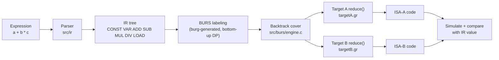

# BURS-Based Retargetable Instruction Selection

**Compiler Design – BCSE307L · Project A24 · Team 8** · Faculty: Dr. Shalini L

Vineet Kumar Mishra · Mayank Verma · Utsav Keshrwani (24BCE2434) · Ahmad Azim (24BCT0119)

A compact, educational **Bottom-Up Rewrite System (BURS)** instruction selector.
It takes an arithmetic expression, builds a machine-independent expression-tree
IR, labels the tree bottom-up with minimum-cost states, backtracks the cheapest
cover from the root, and emits code for **two different instruction sets from
the same tree and the same engine**:

| | Target A | Target B |
|---|---|---|
| Machine | 3-address load/store register machine | 0-address stack machine |
| Grammar | [`targetA.gr`](src/targets/targetA/targetA.gr), 11 rules | [`targetB.gr`](src/targets/targetB/targetB.gr), 17 rules |
| Nonterminals | `reg`, `imm` | `stk`, `mem`, `imm` |
| `a + b * c` | `LOAD r0,[a]` `LOAD r1,[b]` `LOAD r2,[c]` `MUL r3,r1,r2` `ADD r4,r0,r3` (cost 6) | `PUSH [a]` `PUSH [b]` `MULM [c]` `ADD` (cost 5) |

Every run also **simulates the generated code** on a model of each target
machine and checks the result against the IR's own evaluation, so a wrong cover
or a wrong emitter shows up as a failure.

---

## Quick start

Needs only a C compiler (`cc`, `gcc` or `clang`) and `make`.

```bash
make
```

```bash
./build/burs "a + b * c"
```

The first `make` builds the third-party `burg` generator, runs it on both target
grammars, then compiles everything into `build/burs`.

### Commands

| Command | What it shows |
|---|---|
| `./build/burs "a + b * c"` | IR tree, cover, code, cost and simulation check for both targets |
| `./build/burs -v "load(a) + 4"` | adds the per-node BURS cost table (the DP labeling) |
| `./build/burs -t A "a - 1"` | one target only (`-t A`, `-t B`, `-t both`) |
| `./build/burs -D a=10 "a * a"` | set variable values used by the simulation check |
| `./build/burs --rules` | rule tables (pattern, cost, instruction template) for both targets |
| `./build/burs --suite` | summary table for the review sample expressions |
| `./build/burs --exhaustive` | runs every tree of depth ≤ 2 (3,333 trees) through both targets, and compares cost with a naive selector |
| `./build/burs --bench` | times labeling on random trees from 405 to 240k nodes |
| `./build/burs -i` | interactive: type expressions one per line, `quit` to exit |
| `make test` | full regression suite (31 stored cases + suite + exhaustive) |
| `make results` | regenerate the evidence files in [`results/`](results) |

**Expression syntax:** `+ - * /`, integer constants, variable names, parentheses,
and memory loads written `[e]` or `load(e)`. Precedence: `*` and `/` bind tighter
than `+`/`-`; all are left-associative. Division truncates toward zero, like C.
Unary minus, `%` and other operators are rejected with a clear error (exit
status 2). If an expression divides by zero with the current test values, code
is still generated but the simulation check is not run (exit status 3); change
the values with `-D`.

---

## Demo walkthrough (for the lab)

1. **Build from clean:** `make clean && make`. Point out the three steps: build
   burg → `burg -p burmA` / `burg -p burmB` generate the two matchers → compile.
2. **Show the rule tables:** `./build/burs --rules`. The two targets are just
   two grammar files. Same `%term` operators, different rules and costs.
3. **One expression, two ISAs:** `./build/burs "a + b * c"`. Walk through:
   the IR tree → Target A cover → Target A code → Target B cover → Target B code
   → the retargeting summary. Note that both simulations print `OK`.
4. **Show the DP (cost) table and a cost-based choice:** `./build/burs -v -t A "load(a) + 4"`.
   At node `n3 CONST 4` both `reg: CONST` (cost 1) and `imm: CONST` (cost 0)
   are recorded; at the root `reg: ADD(reg,imm)` → `ADDI` wins with total cost 3,
   instead of `LOADI` + `ADD` (cost 4).
5. **Target B's memory operands:** `./build/burs -v -t B "(a + b) * c"` gives
   `PUSH [a]; ADDM [b]; MULM [c]` (cost 4). Target A needs 5 instructions (cost 6).
6. **Invalid input:** `./build/burs "a % b"` and `./build/burs "(a + b"` give
   a clear error with the column number.
7. **Evidence of correctness:** `make test`, which ends with `33 passed, 0 failed`.

---

## How it works



**Machine-independent layer:** [`src/ir`](src/ir) (node type, builders,
parser, reference evaluator) and [`src/burs`](src/burs) (the engine plus the
`Target` interface). Nothing here names an instruction.

**Target description layer:** one `.gr` file per target. Its rules section is
read by burg; its C footer holds the rule table, the `reduce()` emitter, a
simulator for that ISA, and exports one `const Target` object.

**Algorithm.** This is the review pseudocode, as implemented:

```
for each node in postorder:                      burmX_label()  (generated tables)
    for each nonterminal N:
        best[N] = min over rules R deriving N that match here of
                  cost(R) + Σ best[child NT] of R's children
backtrack from (root, start NT):                 burs_reduce()  (engine.c)
    R = best rule for (node, NT)
    reduce each child of R with the NT that R requires (left to right)
    target.reduce(R, child operands) → emits instructions, returns operand
```

burg does the dynamic programming at **table-generation time**: it computes
every state a node can be in (a state is the set of best rules for every
nonterminal, with costs normalised). Labeling a tree at run time is therefore
one table lookup per node. `burs_cost()` recomputes the absolute costs from the
selected rules for display.

**Chain rules** such as `stk: mem` let one node satisfy several nonterminals.
In Target B a variable is `mem` (cost 0, an operand) or `stk` (cost 1,
`PUSH`). The parent picks whichever makes the total cheapest, which is why
`b * c` becomes `PUSH [b]; MULM [c]` rather than two pushes and a `MUL`.

### Target A: register machine (11 rules)

| # | Rule | Cost | Emits |
|---|---|---|---|
| 1 | `reg: VAR` | 1 | `LOAD rd,[var]` |
| 2 | `reg: CONST` | 1 | `LOADI rd,#k` |
| 3 | `imm: CONST` | 0 | (operand `#k`) |
| 4 | `reg: LOAD(reg)` | 1 | `LOAD rd,[rs]` |
| 5 | `reg: ADD(reg,reg)` | 1 | `ADD rd,ra,rb` |
| 6 | `reg: ADD(reg,imm)` | 1 | `ADDI rd,ra,#k` |
| 7 | `reg: SUB(reg,reg)` | 1 | `SUB rd,ra,rb` |
| 8 | `reg: SUB(reg,imm)` | 1 | `SUBI rd,ra,#k` |
| 9 | `reg: MUL(reg,reg)` | 2 | `MUL rd,ra,rb` |
| 10 | `reg: DIV(reg,reg)` | 3 | `DIV rd,ra,rb` |
| 11 | `reg: DIV(reg,imm)` | 3 | `DIVI rd,ra,#k` |

### Target B: stack machine (17 rules)

| # | Rule | Cost | Emits |
|---|---|---|---|
| 1 | `stk: mem` | 1 | `PUSH [var]` |
| 2 | `stk: imm` | 1 | `PUSHI #k` |
| 3 | `mem: VAR` | 0 | (operand `[var]`) |
| 4 | `imm: CONST` | 0 | (operand `#k`) |
| 5 | `stk: LOAD(stk)` | 1 | `LOAD` |
| 6–8 | `stk: ADD(stk, stk / mem / imm)` | 1 | `ADD` / `ADDM [var]` / `ADDI #k` |
| 9–11 | `stk: SUB(stk, stk / mem / imm)` | 1 | `SUB` / `SUBM [var]` / `SUBI #k` |
| 12–14 | `stk: MUL(stk, stk / mem / imm)` | 2 | `MUL` / `MULM [var]` / `MULI #k` |
| 15–17 | `stk: DIV(stk, stk / mem / imm)` | 3 | `DIV` / `DIVM [var]` / `DIVI #k` |

---

## Results

Review sample expressions (from [`results/sample_runs.txt`](results/sample_runs.txt);
test values `a=2, b=3, c=4`, `mem[x] = 1000 + x`):

| Expression | Target A code | A cost | Target B code | B cost | Simulated |
|---|---|---|---|---|---|
| `a + b * c` | `LOAD r0,[a]; LOAD r1,[b]; LOAD r2,[c]; MUL r3,r1,r2; ADD r4,r0,r3` | 6 | `PUSH [a]; PUSH [b]; MULM [c]; ADD` | 5 | 14 ✓ |
| `(a + b) * c` | `LOAD r0,[a]; LOAD r1,[b]; ADD r2,r0,r1; LOAD r3,[c]; MUL r4,r2,r3` | 6 | `PUSH [a]; ADDM [b]; MULM [c]` | 4 | 20 ✓ |
| `a + b + c` | `LOAD r0,[a]; LOAD r1,[b]; ADD r2,r0,r1; LOAD r3,[c]; ADD r4,r2,r3` | 5 | `PUSH [a]; ADDM [b]; ADDM [c]` | 3 | 9 ✓ |
| `a * (b + c)` | `LOAD r0,[a]; LOAD r1,[b]; LOAD r2,[c]; ADD r3,r1,r2; MUL r4,r0,r3` | 6 | `PUSH [a]; PUSH [b]; ADDM [c]; MUL` | 5 | 14 ✓ |
| `a - b + c` | `LOAD r0,[a]; LOAD r1,[b]; SUB r2,r0,r1; LOAD r3,[c]; ADD r4,r2,r3` | 5 | `PUSH [a]; SUBM [b]; ADDM [c]` | 3 | 3 ✓ |
| `load(a) + 4` | `LOAD r0,[a]; LOAD r1,[r0]; ADDI r2,r1,#4` | 3 | `PUSH [a]; LOAD; ADDI #4` | 3 | 1006 ✓ |

The Target A sequences and costs are identical to those recorded in the Review 2
document (Section 13). Target B, which was pending at Review 2, is now complete.

Exhaustive check ([`results/exhaustive_check.txt`](results/exhaustive_check.txt)):
all 3,333 trees of depth ≤ 2 over `{a, b, 3}` with ADD/SUB/MUL/LOAD are covered
by both targets, and all 6,666 generated programs simulate to the IR value.
Over the same trees, a naive one-instruction-per-node selector (same cost
model) averages cost 7.26. BURS averages **6.88 on Target A (5.2% lower)** and
**5.55 on Target B (23.6% lower)**. Target B gains more because its memory
operands remove most `PUSH` instructions.

Benchmark ([`results/benchmark.txt`](results/benchmark.txt)): labeling plus the
cover-cost backtrack takes roughly 10–20 ns per node from 405 to 240k nodes,
i.e. linear time, because burg precomputes all the dynamic programming into
tables.

---

## Testing

`make test` runs [`tests/run_tests.sh`](tests/run_tests.sh). Each case in
[`tests/cases.txt`](tests/cases.txt) is run and its full output (stdout, stderr
and exit status) is compared byte-for-byte with
[`tests/expected/<id>.out`](tests/expected):

| Category | Cases | Checks |
|---|---|---|
| Positive | the six review expressions, `(a + b) / c`, a mixed expression with division | tree, cover, code, cost, simulation |
| Boundary | single variable, single constant, 20-variable deep nesting, multi-letter names, nested loads, large constants, `(0 - 7) / 2` | leaf handling; correct bottom-up order at depth; division truncates toward zero |
| Rule choice | `a + 7`, `7 + a`, `a - 1`, `a * b` (B), `a * 5` (B), `a / 2` (A), `a / b` (B) | cheapest matching rule wins (ADDI, SUBI, MULM, MULI, DIVI, DIVM) |
| Negative | `a % b`, `a + * b`, `(a + b`, `[a + b`, `a b`, `a * -b`, empty, `a + $` | clear error message, exit status 2 |
| Failure | `a / (b - b)` | code generated, value undefined (division by zero), check not run, exit status 3 |
| Retargeting | every positive and boundary case runs on both targets | different valid code from the same IR |
| Regression | `--suite` and `--exhaustive` | 10/10 suite, 0 exhaustive failures |

**Test oracles** (from Review 1 §12.1): the tree printout must match the input
structure, the cover cost equals the sum of selected rule costs, the code must
follow the selected cover, and the simulated value must equal `ir_eval()` of the
tree. After an intentional change to output, run `sh tests/run_tests.sh --update`
and review the diff.

---

## Repository layout

```
burs-instruction-selector/
├── Makefile
├── src/
│   ├── ir/            ir.h, ir.c: Node, builders, parser, printer, reference evaluator
│   ├── burs/          target.h: Target interface;  engine.c: cost, cover, reduce
│   ├── targets/
│   │   ├── targetA/   targetA.gr: register machine rules + emitter + simulator
│   │   └── targetB/   targetB.gr: stack machine rules + emitter + simulator
│   └── main/          main.c: command-line driver, suite, exhaustive check
├── tests/             cases.txt, expected/*.out, run_tests.sh, make_results.sh
├── results/           saved outputs: rule tables, sample runs, suite, test report
├── docs/              Review 1–3 documents (Review 3 report as .docx and .pdf), Review 1 slides
└── third_party/burg/  the BURG code-generator generator (see below)
```

### Module interfaces (Review 2 §3.1 → code)

| Review interface | Implementation |
|---|---|
| `Node { type, children, value }` | `struct node { op, state_label, id, ival, name, left, right }` in [`ir.h`](src/ir/ir.h) |
| `Rule { pattern, state, childStates, template, cost }` | grammar rule in the `.gr` file + `RuleInfo` in its footer; child states come from `burmX_nts[]` |
| `StateCost { state, cost, ruleUsed }` | `node->state_label` set by `burmX_label()`; `rule(state, nt)` and `burs_cost()` |
| `MatchResult { rootState, selectedRules }` | `burs_print_cover()` / `burs_reduce()` walking from `(root, start_nt)` |

### Adding a third target

Write `src/targets/targetC/targetC.gr` with the same `%term` line, give it
rules, a `reduce()` and a `simulate()`, and export `const Target targetC`. Then
add one generation rule to the `Makefile` (`burg -p burmC`) and add `&targetC`
to `all_targets[]` in `main.c`. The IR, parser and engine do not change.

---

## Progress since Review 2

| Review 2 pending item | Status |
|---|---|
| Define Target-B rule table | Done: 14 rules, stack ISA with memory and immediate operands |
| Implement Target-B emitter | Done: `reduceB()` in `targetB.gr` |
| Run all test expressions through Target B | Done: see Results |
| Expand regression suite to both targets | Done: 31 stored cases + suite + exhaustive check |
| Defect D3 (Target-B emitter missing) | Closed |
| Push to team GitHub repository | Done: this repository |

Known limitations (unchanged scope): expression trees only (no DAGs or
statements), unlimited virtual registers (no register allocation or spilling),
cost ties are settled once by burg's table generator, not at run time, no
unary minus or `%`. Division (`DIV`) was added after Review 3 preparation; the
exhaustive check and the results in this README cover ADD/SUB/MUL/LOAD trees.

---

## Third-party code

[`third_party/burg`](third_party/burg) is **BURG**, the code-generator generator
by C. W. Fraser, D. R. Hanson and T. A. Proebsting, in the modernised version
maintained by Chen Zhexuan ([github.com/CloseToZero/burg](https://github.com/CloseToZero/burg)).
It is included unmodified as a build tool, under its own licence
([`COPYRIGHT`](third_party/burg/COPYRIGHT), [`LICENSE.TXT`](third_party/burg/LICENSE.TXT)).
This project's own code is everything under `src/` and `tests/`, and the Makefile.

## References

1. A. V. Aho, M. S. Lam, R. Sethi, J. D. Ullman, *Compilers: Principles, Techniques, and Tools*, 2nd ed., Addison-Wesley, 2006, Ch. 8 (Code Generation).
2. A. V. Aho, M. Ganapathi, S. W. K. Tjiang, "Code Generation Using Tree Matching and Dynamic Programming," *ACM TOPLAS* 11(4), 1989.
3. C. W. Fraser, D. R. Hanson, T. A. Proebsting, "Engineering a Simple, Efficient Code-Generator Generator," *ACM LOPLAS* 1(3), 1992.
4. C. W. Fraser, R. R. Henry, T. A. Proebsting, "BURG: Fast Optimal Instruction Selection and Tree Parsing," *SIGPLAN Notices* 27(4), 1992.
5. T. A. Proebsting, "Simple and Efficient BURS Table Generation," *PLDI*, 1992.
6. Chen Zhexuan, *burg*, https://github.com/CloseToZero/burg.
